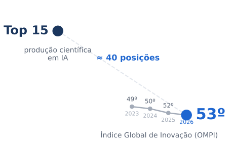
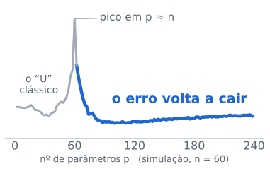
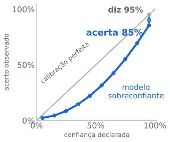
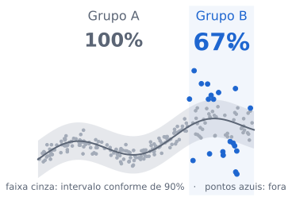

## {.capa}

::: {.capa style="margin-top:-2.5em"}
[Inteligência Artificial, Inovação e Transformação da Ciência]{.titulo}

[Uma perspectiva estatística: fundamentos, incerteza e soberania]{.sub}

<br/>

::: {.autor}
**Prof. Dr. Jodavid Ferreira**<br>
Departamento de Estatística · CCEN · Universidade Federal de Pernambuco
:::

<br/>

::: {.evento}
Mesa-redonda do IV Workshop de Divulgação Científica e Didáticas (IV WDCD)<br>
15 de outubro de 2026 · Auditório do CCEN
:::
:::

::: notes
**0:15** · Boa tarde. Sou Jodavid Ferreira, do Departamento de Estatística. Vou trazer o olhar da Estatística: o que a IA muda na ciência, e o que ela **não** muda — saber quanto podemos confiar numa resposta.

Plano de tempo (no seu ritmo): **4:00 → slide 7 · 7:30 → slide 12 · 11:00 → slide 17 · fim ≈ 13:00**. Cada slide tem um item *"Se sobrar tempo"*: use só se estiver adiantado.
:::

## A IA acelera respostas. Quem garante as perguntas?

<br/>

::: {.grande}
Modelos geram código, resumem a literatura e acham padrões **em segundos**.
:::

::: {.grande style="margin-top:0.5em"}
[Mas quem garante a qualidade das perguntas, a validade das evidências e o rigor das decisões?]{.d}
:::

<br/>

<!-- ::: {.fragment} -->
::: {.mensagem}
Tecnologia gera possibilidades; [critérios estatísticos transformam possibilidades em ciência]{.marca}.
:::
<!-- ::: -->

::: notes
**0:40** · Leia a pergunta em azul e faça uma **pausa de 2 segundos**.

"Isso é real e útil. Mas ciência nunca foi só produzir respostas: é saber de onde vieram os dados, quanto a resposta varia e se o padrão é causa ou coincidência."

**[clique]** → aparece o fio condutor. Leia.

*Se sobrar tempo:* Breiman (2001), "as duas culturas": modelagem de dados × modelagem algorítmica.
:::

## A IA já está na ciência. Replicar ciência, nem tanto.

<br/>
<br/>

::: {.trio}
::: {}
[+26%]{.hero .m .cinza}
[artigos com IA nas <b style="color:#1e66d0">CIÊNCIAS NATURAIS</b> em um ano (≈ 80 mil em 2025)]{.hero-leg .ctx}
:::
::: {}
[6–9%]{.hero .m .cinza}
[da produção científica já envolve IA, conforme a área (<b style="color:#1e66d0">< 1% em 2010</b>)]{.hero-leg .ctx}
:::
::: {}
[88%]{.hero .m .cinza}
[das organizações usam IA em ao menos uma função (McKinsey, 2025)]{.hero-leg .ctx}
:::
:::

<br/>

<!-- ::: {.fragment style="margin-top:0.9em"} -->
:::: {.columns}
::: {.column width="34%"}
[< 20%]{.hero .verm}
:::
::: {.column .pt width="66%"}
de acerto dos modelos de fronteira ao tentar **replicar** artigos de <b style="color:#1e66d0">astrofísica</b> (ReplicationBench).

[Gerar ficou barato. **Auditar** virou a competência decisiva.]{.marca-r}
:::
::::
<!-- ::: -->

[Fonte: Stanford HAI, *AI Index Report 2026*; McKinsey, *State of AI 2025*.]{.fonte}

::: notes
**0:40** · Os três números em cinza são o contexto: "cerca de 80 mil artigos com IA nas ciências naturais em 2025, 26% a mais; entre 6% e 9% da produção científica; 88% das organizações usam IA."

**[clique]** → o número em azul. "Mas o mesmo relatório mostra que, ao replicar artigos de astrofísica, os modelos acertam menos de 20%. Gerar ficou barato; auditar ficou caro."
:::

## Top 15 em ciência sobre IA. 53º em inovação.

:::: {.columns}
::: {.column width="60%"}
::: {.figura}

:::
[Fontes: CGEE (2025); OMPI, *Global Innovation Index* 2023–2026 (139 economias).]{.mpeq .ctx}
:::
::: {.column .pt style="margin-top:2.5em; width:40%;"}
Publicamos muito, mas [convertemos pouco]{.marca-r} em produtos, patentes e empresas, e a posição **vem caindo**.

::: {.mensagem}
"Se o conhecimento não vira solução para a sociedade, vira autoelogio."
:::
<!-- [Prof. Anderson Soares (CEIA-UFG), podcast *IA Sob Controle*, ep. 288]{.mpeq .ctx} -->
:::
::::

::: notes
**0:45** · "O professor Anderson Soares, da UFG, aponta um paradoxo. O Brasil está entre os 15 países que mais publicam sobre IA. Mas no Índice Global de Inovação, que mede a conversão em produtos, patentes e empresas, está em 53º, e caindo: 49, 50, 52, 53." Aponte o ponto azul.

Se citarem o "72º" do podcast: "o número atual do índice é 53º, mas o argumento se mantém".

*Se sobrar tempo:* no GII 2025, melhor em resultados (50º) do que em insumos (63º); única economia latino-americana com P&D acima de 1% do PIB.
:::

## O Brasil deve competir com dados e problemas locais

<br/>

:::: {.columns}
::: {.column width="55%"}
::: {.camadas}
::: {.camada .c1 .apagada}
[1. Modelos de fronteira]{.t}<br>[escala de capital de outra ordem]{.d}
:::
::: {.camada .c2 .foco}
[2. Adaptação e especialização]{.t}<br>[SLMs, ajuste fino, dados e domínios locais]{.d}
:::
::: {.camada .c3 .foco}
[3. Aplicação estratégica]{.t}<br>[SUS · agro · clima · energia]{.d}
:::
:::
:::
::: {.column .pt width="45%"}
Nas camadas 2 e 3 estão [problemas que ninguém lá fora vai resolver por nós]{.marca}.

<br/>

<span style="color:#1e66d0">A lição dos **genéricos**: capacidade nacional gera autonomia e poder de barganha.</span>

::: {.mensagem}
É onde desenho amostral e validação local decidem.
:::
:::
::::

::: notes
**0:35** · "Na camada 1, apagada no slide, a escala de capital é de outra ordem. Mas adaptar modelos a dados locais e aplicá-los em saúde, agro, clima: aí temos problemas que ninguém lá fora vai resolver por nós. A analogia do professor Anderson é a dos genéricos."

Ponte: "um modelo treinado em hospitais americanos é, para o SUS, um modelo fora da distribuição."

*Se sobrar tempo:* PBIA 2024–2028, cerca de R$ 23 bilhões; meta de catalogar 2.000 bases públicas até 2027.
:::

## A IA acelerou uma etapa. A Estatística decide as outras.

<br/>

::: {.grande style="font-size:1.25em"}
Todo modelo, do mais simples ao maior LLM, aproxima o mecanismo gerador $P(X,Y)$ a partir de uma **amostra finita**
<!-- : [é inferência indutiva]{.marca}. -->
:::

<br/>
<br/>

::: {.ciclo style="margin-top:1em"}
[Mecanismo gerador]{.etapa .est}
[→]{.seta}
[Desenho amostral e coleta]{.etapa .est}
[→]{.seta}
[Otimização <span style="font-weight:400">(a IA acelerou)</span>]{.etapa .ia}
[→]{.seta}
[Validação e incerteza]{.etapa .est}
[→]{.seta}
[Decisão]{.etapa .est}
:::

::: {.retorno}
a validação volta e questiona como os dados foram coletados
:::

<br/>

<!-- ::: {.trio style="margin-top:0.8em;font-size:0.8em"}
::: {.ctx}
**Sensibilidade:** quanto muda com outra amostra?
:::
::: {.ctx}
**População:** o treino é a de aplicação?
:::
::: {.ctx}
**Estrutura:** padrão real ou espúrio?
:::
::: -->

::: notes
**0:45** · "Todo modelo tenta aproximar o mecanismo que gera os dados a partir de uma amostra. Isso é inferência indutiva."

Aponte a faixa: "A IA acelerou muito a etapa cinza, a otimização. As etapas em azul (desenho, validação, decisão) continuam sendo decididas por critérios estatísticos."

As três perguntas em cinza: leia rápido ou só aponte.

*Se sobrar tempo:* aprender = minimizar o risco $R(f)$; só vemos o risco empírico; a diferença é um problema de estimação.
:::

## Mais dados não corrigem dados ruins

<br/>
<br/>
<br/>


::: {.duo style="margin-top:0.2em"}
::: {}
[Delphi–Facebook · ~250 mil respostas/semana]{.rot .ctx}
[+17 p.p.]{.hero .cinza style="font-size:2.4em"}
[de erro na vacinação contra Covid (1ª dose, adultos dos EUA, maio/2021), com IC 95% tão estreito que [nem aparece no gráfico]{.marca}]{.hero-leg .ctx style="font-size:0.72em"}
:::
<!-- ::: {.fragment} -->
::: {}
[Axios–Ipsos · ~1 mil respostas/onda]{.rot}
[+4,2 p.p.]{.hero .ouro style="font-size:2.4em"}
[de erro; o IC 95% conteve o valor oficial do CDC em [10 de 11 ondas]{.marca} (cobertura empírica de 91%)]{.hero-leg style="font-size:0.72em"}
:::
<!-- ::: -->

<!-- :::

::: {.numeros style="margin-top:0.7em;font-size:0.8em"}
::: {.numero}
::: {.v style="font-size:2em"}
&lt; 10
:::
::: {.d}
***n* efetivo** da Delphi–Facebook em abril/2021: 250 mil respostas valem menos que 10 por amostragem aleatória simples (redução de 99,99%)
:::
:::
::: {.numero}
::: {.v style="font-size:2em"}
+14 p.p.
:::
::: {.d}
Census Household Pulse, ~75 mil respostas/onda: redução de mais de 99% no *n* efetivo
:::
:::
::: {.numero}
::: {.v style="font-size:2em"}
1,1–1,2
:::
::: {.d}
efeito de desenho do Axios–Ipsos: painel KnowledgePanel recrutado por **amostra probabilística de endereços**, com internet fornecida a quem não tem
:::
::: -->

:::

<br/>
<br/>

[Referência: contagem oficial de 1ª doses do CDC. Totais jan.–mai./2021: Delphi–Facebook 4.525.633 (19 ondas); Household Pulse 606.615 (8); Axios–Ipsos 11.421 (11). Bradley et al. (2021), *Nature*, 600, 695–700.]{.fonte}

::: notes
**0:45** · "Dados são construções humanas. Um exemplo real, publicado na *Nature*: em 2021, três pesquisas mediram a vacinação contra Covid nos EUA, e o CDC tinha o número oficial para comparar."

"A Delphi–Facebook, com 250 mil respostas por semana, errou em 17 pontos percentuais, e o intervalo de confiança dela era tão estreito que nem aparecia no gráfico: precisão sem acurácia."

**[clique]** → "O Axios–Ipsos, com cerca de mil respostas por onda, errou 4,2 pontos, e o intervalo de 95% conteve o valor do CDC em 10 de 11 ondas. A diferença foi o desenho: recrutamento probabilístico por endereço."

Aponte o "< 10": "Por causa do viés de seleção, as 250 mil respostas da Delphi–Facebook valeram o mesmo que menos de 10 pessoas sorteadas ao acaso. Se a qualidade é ruim, quantidade não salva."

*Se perguntarem:* os erros cresceram com o tempo, de poucos pontos em janeiro para 4,2 / 14 / 17 p.p. em meados de maio. O CDC está como referência (não é verdade absoluta); os autores testaram ±5% e ±10% de erro no CDC e a conclusão se mantém. A Delphi–Facebook não pondera por escolaridade: quem não tem curso superior ficou sub-representado em quase 20 p.p.
:::

## Com mais parâmetros que dados, o erro volta a cair

<p></p>

:::: {.columns}
::: {.column width="40%"}
[*Clássico* ($n > p$)]{.ctx}: uma solução.

$$
\hat{\beta} = (X^\top X)^{-1}X^\top y
$$

<br/>

**Moderno ($p \gg n$)**: [infinitas soluções]{.marca}; a regularização escolhe uma.

$$
\hat{\beta}_{\text{ridge}} = (X^\top X + \lambda I)^{-1}X^\top y
$$

::: {.mensagem style="margin-top:1.5em"}
O desafio é escolher, entre infinitas soluções, a que generaliza.
:::
:::

::: {.column width="60%"}
::: {.figura}

:::

[Belkin et al. (2019); Hastie et al. (2022).]{.mpeq .ctx}
:::
::::


::: notes
**0:50** · "No mundo clássico, mínimos quadrados dá uma única solução. Nos modelos modernos, os parâmetros superam muito as observações: infinitas soluções. O problema passa a ser escolher a que generaliza; é o papel da regularização."

Gráfico: "Aprendemos o U, em cinza. Belkin e colegas mostraram que, depois do pico em p ≈ n, o erro volta a cair, em azul. Isso foi explicado com ferramentas estatísticas."

Se perguntarem: Gauss–Markov = variância mínima entre estimadores **lineares não viesados**; com regularização ótima, o pico some.
:::

<!-- ## Diz 95%, acerta 85%: fluência não é calibração

<br/>

:::: {.columns}
::: {.column width="50%"}
::: {.figura}

:::
:::
::: {.column .pt width="50%"}
Calibrado é quem, ao dizer "90%", [acerta 90% das vezes]{.marca}.

Redes profundas modernas tendem a ser **sobreconfiantes** (Guo et al., 2017). []{.ctx}

<!-- [Medir: Brier, ECE. Corrigir: Platt, isotônica, *temperature scaling*.]{.ctx .peq}

<br/>

::: {.mensagem .verm}
Confiança em texto fluente não é probabilidade, até ser verificada.
:::
:::
::::

::: notes
**0:40** · "Calibração: entre todas as vezes que o modelo diz 90%, ele acerta 90%? Redes profundas tendem a ser sobreconfiantes: dizem 95% e acertam perto de 85%. Texto fluente e seguro não é evidência de probabilidade correta."

Nuance se perguntarem: o GPT-4 pré-treinado era razoavelmente calibrado; o RLHF piorou (OpenAI, 2023).
:::

-->

## Na média, 90% de cobertura. No grupo B, 67%.

<br/>

:::: {.columns}
::: {.column width="42%"}
A **predição conforme** dá a qualquer modelo intervalos com [cobertura mínima garantida]{.marca} em amostra finita:

$$P\big(Y_{n+1} \in C(X_{n+1})\big) \ge 1-\alpha$$

[Exige permutabilidade. A garantia é **marginal**: vale na média, não em cada grupo.]{.ctx .peq}
:::
::: {.column style = "width:58%; margin-top:-2cm;"}
::: {.figura}

:::
:::
::::

::: {.mensagem .verm style="margin-top:0.2em"}
Média boa esconde subgrupo ruim: a auditoria tem de ser estratificada.
:::

::: notes
**0:50** · "A predição conforme pega qualquer modelo e entrega um intervalo com cobertura mínima garantida, por exemplo 90%, em amostra finita, sem supor normalidade. É um 'não sei' quantificado."

Aponte os números: "Mas a garantia é na média. Nesta simulação: 90% no total, 100% no grupo A e só 67% no grupo B. No SUS, no crédito, na seleção, isso é uma questão ética."

Não diga "cobertura exata". Solução prática: conformal por grupo (Mondrian).

*Se sobrar tempo:* Obermeyer et al. (2019, *Science*): gasto como proxy de necessidade sub-encaminhava pacientes negros.
:::

## Prever não é intervir

<br/>

:::: {.columns}
::: {.column width="55%"}
```{=html}
<svg viewBox="0 0 560 320" width="100%" role="img" aria-label="Temperatura causa venda de sorvete e afogamentos; os dois aparecem associados">
  <defs>
    <marker id="ah" viewBox="0 0 10 10" refX="9" refY="5" markerWidth="7" markerHeight="7" orient="auto-start-reverse"><path d="M0,0 L10,5 L0,10 z" fill="#1E66D0"/></marker>
  </defs>
  <rect x="180" y="14" width="200" height="62" rx="4" fill="#EAF2FC" stroke="#1E66D0" stroke-width="3"/>
  <text x="280" y="53" text-anchor="middle" font-family="IBM Plex Sans, sans-serif" font-size="24" font-weight="600" fill="#134A9C">Temperatura</text>
  <rect x="4" y="214" width="200" height="60" rx="4" fill="#F0F2F5" stroke="#A3ABB8" stroke-width="2"/>
  <text x="104" y="251" text-anchor="middle" font-family="IBM Plex Sans, sans-serif" font-size="21" font-weight="600" fill="#5B6575">Venda de sorvete</text>
  <rect x="356" y="214" width="200" height="60" rx="4" fill="#F0F2F5" stroke="#A3ABB8" stroke-width="2"/>
  <text x="456" y="251" text-anchor="middle" font-family="IBM Plex Sans, sans-serif" font-size="21" font-weight="600" fill="#5B6575">Afogamentos</text>
  <line x1="235" y1="78" x2="130" y2="208" stroke="#1E66D0" stroke-width="4" marker-end="url(#ah)"/>
  <line x1="325" y1="78" x2="430" y2="208" stroke="#1E66D0" stroke-width="4" marker-end="url(#ah)"/>
  <line x1="210" y1="244" x2="350" y2="244" stroke="#1E66D0" stroke-width="3" stroke-dasharray="8 6"/>
  <text x="280" y="232" text-anchor="middle" font-family="IBM Plex Sans, sans-serif" font-size="18" fill="#1E66D0">associação</text>
  <text x="280" y="308" text-anchor="middle" font-family="IBM Plex Sans, sans-serif" font-size="20" font-weight="600" fill="#1E66D0">proibir sorvete não reduz afogamentos</text>
</svg>
```
:::
::: {.column style="width: 45%; margin-top: -2.5cm;"}
A escada de Pearl:

1. **Associação** $P(y \mid x)$: o que observamos e usamos para predizer.
2. **Intervenção** $P(y \mid do(x))$: o que acontece quando definimos $X=x$.
3. **Contrafactual** $Y_x$: o que teria acontecido se $X$ tivesse assumido outro valor.

[Sem desenho ou suposições causais, dados observacionais não identificam efeitos, **não importa o tamanho do modelo**.]{.peq}
:::
::::

::: {.mensagem}
Prever quem vai adoecer não diz qual tratamento funciona.
:::

::: notes
**0:40** · "Pearl organiza em três degraus: associação, intervenção, contrafactual. A maior parte dos modelos preditivos vive no primeiro, em cinza. Ciência, medicina e política pública perguntam sobre o segundo e o terceiro."

Diagrama em uma frase: "sorvete e afogamentos andam juntos por causa da temperatura; proibir sorvete não salva ninguém." Fisher: o ensaio randomizado torna observar e intervir iguais por desenho.
:::

## Quatro perguntas antes de confiar em um modelo

<br/>

::: {.perguntas}
::: {.pq}
[1]{.n}
[Bate um modelo simples?]{.t}
[Em 71 estudos clínicos, o ML não superou, em média, a regressão logística (Christodoulou et al., 2019).]{.e}
:::
::: {.pq}
[2]{.n}
[Funciona em [outro hospital]{.marca}, outra cidade, outro equipamento?]{.t}
[Modelo de pneumonia em raio-X aprendeu a reconhecer *o hospital*, não a doença (Zech et al., 2018).]{.e}
:::
::: {.pq}
[3]{.n}
[É estável a pequenas perturbações?]{.t}
[Modelos de Covid usavam marcas de texto na imagem (DeGrave et al., 2021).]{.e}
:::
::: {.pq}
[4]{.n}
[Sabe dizer quando **não sabe**?]{.t}
[Intervalos, calibração, abstenção.]{.e}
:::
:::

<br/>

::: {.mensagem}
Não "o modelo acerta?", mas: em que condições, para quem, com que margem de erro?
:::

::: notes
**0:40** · "Para quem vai usar IA na pesquisa amanhã: quatro perguntas." Leia as perguntas. Cite só o exemplo destacado (o hospital).

*Se sobrar tempo:* Wynants et al. (2020, *BMJ*): centenas de modelos de Covid, quase todos com alto risco de viés.
:::

## Uma conferência, 29 mil artigos: volume não é ciência

<br/>

::: {.duo style="margin-top:0.4em"}
::: {}
[≈ 29 mil]{.hero .verm}
[submissões à trilha principal da AAAI-26, quase o dobro de 2025]{.hero-leg}
[AAAI; OpenReview (2026)]{.hero-fonte}
:::
::: {}
[6,5–16,9%]{.hero .m .cinza}
[do texto de revisões em conferências de IA (2023–24) modificado por LLMs, estimado por **máxima verossimilhança**]{.hero-leg .ctx}
[Liang et al. (2024), ICML]{.hero-fonte}
:::
:::

<br/>


::: {.mensagem style="margin-top:1em"}
A Universidade precisa valorizar profundidade, reprodutibilidade e impacto real.
:::

::: notes
**0:30** · "A AAAI de 2026 recebeu quase 29 mil artigos na trilha principal, quase o dobro do ano anterior. E estima-se que uma fração relevante das próprias revisões já é escrita com ajuda de LLMs; até essa detecção é um problema de estimação. Volume não é ciência."

Primeiro corte se estiver atrasado.
:::

## O código roda. O resultado pode ser falso.

<br/>


:::: {.columns}
::: {.column width="42%"}
[**Aceleração legítima:** AlphaFold (Nobel 2024), simulação, Monte Carlo.]{.ctx}

[**Riscos:** equações erradas, citações inventadas, ilusão de entendimento.]{.ctx}


<!-- ::: {.fragment} -->
[97%]{.hero .cinza style="margin-top:.5em"}
[de acurácia aparente não prova nada.]{.hero-leg}
<!-- ::: -->
:::
::: {.column style="width: 58%; margin-top: -1.5cm;"}
Os erros mais comuns são **silenciosos**:

<br/>

- **Vazamento:** padronizar, imputar ou selecionar variáveis [antes de separar treino e teste]{.marca-r}.
- **Dependência ignorada:** mesmo paciente ou série temporal tratados como i.i.d.
<!-- - **Sobreajuste por tentativas:** o jardim dos caminhos que se bifurcam. -->

[Kapoor & Narayanan (2023): vazamento em centenas de artigos de 17 áreas.]{.mpeq .ctx}
:::
::::

::: {.mensagem}
O computador não vê esses erros; a Estatística vê. A responsabilidade autoral não se transfere.
:::

::: notes
**0:45** · "Há aceleração legítima em todas as áreas do CCEN. Mas há riscos: equações erradas, citações inventadas."

"O pior erro é o silencioso. O código roda, a perda converge…" **[clique]** "…97% de acurácia. E o resultado pode ser falso: vazamento, dependência ignorada, sobreajuste por tentativas. O computador não vê; a Estatística vê."

*Se sobrar tempo:* 1.000 variáveis de puro ruído, 50 observações; escolher as 10 "mais correlacionadas" antes da validação cruzada dá acurácia alta: a seleção vazou.
:::

## O gargalo não é o hardware: é o dado e quem sabe lê-lo

<br/>

::: {.grande style="font-size:1.3em"}
"Comprar hardware é o passo mais fácil; [o desafio é usá-lo de forma produtiva para o país]{.d}."
:::
<!-- [Anderson Soares (CEIA-UFG)]{.mpeq .ctx} -->

::: {.antes-depois style="margin-top:0.8em"}
::: {.antes}
[O que está saturado]{.rot2}
Usuário de *prompt* pronto e de tutorial, sem base para auditar.
:::
::: {.depois}
[O perfil disputado]{.rot2}
Fundamentos de probabilidade, **rigor de desenho** e capacidade de formular problemas reais.
:::
:::

<br/>

::: {.mensagem}
Bibliotecas mudam a cada dois anos; verossimilhança, amostragem e causalidade, não.
:::

::: notes
**0:45** · "O país está investindo em supercomputação, e isso é indispensável; o colega da Computação vai falar disso melhor do que eu. Mas força bruta sobre dados mal coletados produz erros mais rápido. Subnotificação e censura no SIM, no SINAN, no DATASUS são problemas de desenho, não de processamento."

"O perfil disputado tem fundamentos e rigor de desenho. Isso é o que um curso de Estatística entrega."

**Ponte para o DE/UFPE** (≈ 20 s, se o tempo permitir).
:::

## O que queremos que o estudante aprenda?

<!-- ::: {.grande style="font-size:1.4em"}
Se a máquina resolve a lista em **5 segundos**, a resposta certa [deixou de ser a prova de que ele aprendeu]{.d}.
:::

::: {.antes-depois style="margin-top:0.9em"}
::: {.antes}
[Menos foco exclusivo em]{.rot2}
conta mecânica como fim em si · definições prontas · resposta única previsível
:::
::: {.depois}
[Mais foco em]{.rot2}
dados reais e locais · defesa de premissas · [**discordar da IA com evidência**]{.marca}
:::
:::

[A conta à mão ainda forma intuição; o ponto é não parar nela.]{.peq .ctx}

::: notes
**0:40** · Leia a frase e **pause**.

"Não é abandonar a conta à mão; é não parar nela. Mais dados reais, interpretação, defesa de premissas e, principalmente, capacidade de discordar da IA com evidência."

Apoio: UNESCO (2023, 2024); GAISE (ASA, 2016).
::: -->

<!-- ##  -->

::: {.mensagem style="margin-top:0.8em"}
Avaliar o percurso, não só o produto
:::

<br/>

::: {.antes-depois}
::: {.antes}
[Tarefa antiga]{.rot2}
"Ajuste uma regressão linear múltipla e calcule o intervalo de confiança."

[A IA faz em segundos.]{.peq}
:::
::: {.depois}
[Tarefa adaptada]{.rot2}
"Gere duas modelagens com IA. Aponte onde as hipóteses foram violadas, corrija e [**defenda oralmente** sua escolha]{.marca}."
:::
:::

::: {.mensagem style="margin-top:0.9em"}
Defender uma escolha diante de uma banca é a prova oral da vida real.
:::

[Outras ideias: erros plantados numa análise feita por IA; bases do IBGE e DATASUS; arguição curta por **sorteio** em turmas grandes.]{.peq .ctx}

::: notes
**0:45** · "Um exemplo da minha área. A tarefa antiga: ajuste uma regressão e calcule o intervalo; a IA faz em segundos. A tarefa adaptada: gere duas modelagens com IA, aponte as hipóteses violadas, corrija e defenda oralmente. A IA vira material de estudo; o que se avalia é o julgamento."

Frase de efeito: "arguição por sorteio: uma solução estatística para um problema de escala."
:::

## Quanto maior o impacto, maior a exigência

<br/>

[Viés e equidade , Privacidade (LGPD, art. 11),  Acesso equitativo,  Autoria e integridade]{.ctx .peq}

::: {.regua-wrap}
| | Risco baixo | Risco moderado | Risco alto |
|---|---|---|---|
| Atividade | Brainstorming, revisão de estilo | Análise exploratória, código assistido | **Atribuir notas, selecionar bolsistas, diagnóstico** |
| Governança | Uso livre com leitura crítica | Validação e declaração de uso | **Supervisão humana, explicabilidade, direito a recurso** |
| Pergunta | Faz sentido? | O estimador é válido? | **Quem responde pelo erro?** |
: {.regua}
:::

::: {.mensagem .verm}
O AI Act europeu classifica IA para <b style="color:#1E66d0;">admissão</b> e <b style="color:#1E66d0;">avaliação educacional</b> como alto risco.
:::
[Reg. (UE) 2024/1689, Anexo III. No Brasil, o PL 2.338/2023 também classifica por risco.]{.mpeq .ctx}

::: notes
**0:45** · "Quatro eixos para a universidade: viés, que é antes de tudo representatividade amostral; privacidade; acesso; autoria."

"E uma régua: quanto maior o impacto sobre pessoas, maior a exigência. Revisar estilo é baixo risco; atribuir notas ou selecionar bolsistas é alto risco, e o AI Act europeu diz o mesmo."

Se atrasado: só a frase do título. Verifique na semana o estado do PL 2.338/2023.
:::

## Para continuar a reflexão

<br/>

::: {.citacao}
"A Inteligência Artificial pode acelerar a velocidade das nossas respostas. [Mas a Estatística garante a solidez das nossas perguntas e a calibração das nossas incertezas.]{.ouro-t}"
:::

<br/>

:::: {.columns}
::: {.column width="55%"}
Não seremos consumidores passivos de tecnologia: seremos [**construtores críticos da inovação, com rigor**]{.marca}.
:::
::: {.column width="45%"}
[Muito obrigado!]{style="font-family:'Source Serif 4',serif;font-size:1.5em;font-weight:700;color:#1B365D"}<br>
**Prof. Dr. Jodavid Ferreira**<br>
[Departamento de Estatística - CCEN/UFPE]{.peq}<br>
[jodavid.ferreira@ufpe.br]{.peq} | 
[<http://jodavid.github.io>]{.peq}
:::
::::


::: {.mensagem style="margin-top:0em; font-size:0.7em"}
Feito com auxílio de IA, usando o modelo **Claude Opus 5.5** (Anthropic),
mas **a responsabilidade pelo conteúdo, pelos dados e pelas referências é do autor**.
:::

::: notes
**0:35** · Leia a citação **devagar** (é o momento de reduzir a velocidade).

"A universidade pública não precisa escolher entre usar IA e ser rigorosa. Precisa formar quem usa com rigor. Muito obrigado."

Agradeça à comissão organizadora (Prof. César Diogo) e aos colegas de mesa.
:::

## Referências

::: {.refs}
Angelopoulos, A. N.; Bates, S. (2023). Conformal prediction: a gentle introduction. *Foundations and Trends in ML*, 16(4).

Belkin, M.; Hsu, D.; Ma, S.; Mandal, S. (2019). Reconciling modern machine-learning practice and the classical bias–variance trade-off. *PNAS*, 116(32), 15849–15854.

Bradley, V. C. et al. (2021). Unrepresentative big surveys significantly overestimated US vaccine uptake. *Nature*, 600, 695–700.

Breiman, L. (2001). Statistical modeling: the two cultures. *Statistical Science*, 16(3), 199–231.

CGEE (2025). *O Panorama Brasileiro da Ciência, Tecnologia e Inovação em Inteligência Artificial*.

Christodoulou, E. et al. (2019). No performance benefit of machine learning over logistic regression for clinical prediction models. *J. Clin. Epidemiol.*, 110, 12–22.

DeGrave, A. J.; Janizek, J. D.; Lee, S.-I. (2021). AI for radiographic COVID-19 detection selects shortcuts over signal. *Nature Machine Intelligence*, 3, 610–619.

Guo, C.; Pleiss, G.; Sun, Y.; Weinberger, K. Q. (2017). On calibration of modern neural networks. *ICML*.

Hastie, T.; Montanari, A.; Rosset, S.; Tibshirani, R. (2022). Surprises in high-dimensional ridgeless least squares interpolation. *Annals of Statistics*, 50(2), 949–986.

Kapoor, S.; Narayanan, A. (2023). Leakage and the reproducibility crisis in machine-learning-based science. *Patterns*, 4(9), 100804.

Liang, W. et al. (2024). Monitoring AI-modified content at scale: ChatGPT and AI conference peer reviews. *ICML*.

McKinsey & Company (2025). *The State of AI in 2025*.

Meng, X.-L. (2018). Statistical paradises and paradoxes in big data (I). *Annals of Applied Statistics*, 12(2), 685–726.

Pearl, J. (2009). *Causality: Models, Reasoning and Inference*. Cambridge University Press.

Soares, A. (2026). A nova corrida da IA nas empresas e universidades brasileiras. Podcast *IA Sob Controle*, ep. 288.

Stanford HAI (2026). *The 2026 AI Index Report*, cap. 5 (Science).

União Europeia (2024). Regulamento (UE) 2024/1689 (AI Act), Anexo III.

WIPO/OMPI (2025, 2026). *Global Innovation Index*.

Zech, J. R. et al. (2018). Variable generalization performance of a deep learning model to detect pneumonia in chest radiographs. *PLoS Medicine*, 15(11), e1002683.
:::

::: notes
Não é falado. Deixe projetado durante o debate.
:::

<!-- ## Nota sobre a produção destes slides

::: {.nota-ia}
[Feito com auxílio de IA]{.selo}

Estes slides foram elaborados com auxílio de inteligência artificial, usando o modelo **Claude Opus 5.5** (Anthropic), a partir do material original do autor: revisão de dados, reorganização do roteiro, gráficos e diagramação em Quarto.

Coerente com a mensagem desta fala: o uso de IA está declarado, e **a responsabilidade pelo conteúdo, pelos dados e pelas referências é do autor**.
::: -->
